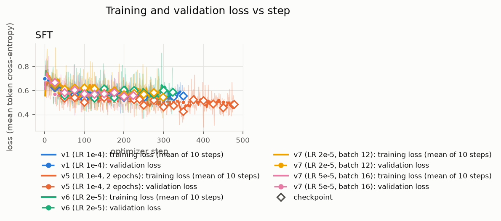

# Post-training of Qwen3.5-9B: LoRA SFT iterations on SWE, terminal and retention data

This repository holds the code, configurations, data manifests, training curves, benchmark results (section 3) and model
links of a post-training experiment on `Qwen/Qwen3.5-9B`: LoRA supervised fine-tuning on open-weight teacher trajectories for
software-engineering (SWE) and terminal agent tasks, iterated over four data and training generations (v1, v5, v6, v7),
evaluated on SWE-bench Pro, Terminal-Bench 2.0 and HLE against the Base model. A second stage (turn-level
on-policy DPO) was designed and its data pipeline partly built, but no stage-2 model was trained.

**Reported SFT model: v7 at LR 5e-5** (`sft_v7lr5e5_20261013_234355`, public adapter
`deanoshuang/qwen3.5-9b-agent-sft-v7-lr5e5-lora`). Of the two v7 arms trained on the same frozen data, the LR 2e-5 arm
failed the development-set check fixed before training (1 of 20 SWE development tasks solved, against 5 for Base, and it
exceeded the pre-declared thinking-length guard), and the LR 5e-5 arm reached the lower validation loss (0.522 against
0.533).

**At a glance**

- **Result:** v7 scores above Base on all three benchmarks: HLE 7.3 → 10.3 % (+3.1 pp, McNemar p < 0.001), SWE-bench Pro hard
  9.8 → 11.8 % (+1 task), Terminal-Bench 2.0 19.1 → 20.2 % (+1 task). Only the HLE gain is significant; with 51 and 89
  tasks, a one-task change is within noise.
- **What the iterations taught:** distilling agent trajectories copies the teacher's *length* before its *efficiency*.
  v1 thought 3.7-5.2x longer than Base; filtering for short attempts (v5, v6) traded that for looping (v5) and for a
  model that rarely acted after long thinking (v6). v7 changes *which turns are trained* (adaptive loss masks that allow
  long thinking only at decision points) rather than which episodes are kept (section 2.2).
- **How decisions were made:** every data and checkpoint choice used a held-out development set frozen before training,
  with decision rules written down before the result was read. The benchmarks were run only on finished models.
- **Budget:** about $1,150 of B200 time over two days (section 7).



## Contents

| Path | What |
|---|---|
| `configs/sft.yaml` | the SFT recipe (the v6 file; v7 runs add CLI overrides) |
| `configs/sft_runs/<run_id>.yaml` | the fully resolved config of every training run, with its CLI overrides and data hashes in the header |
| `configs/stage2.yaml` | the stage-2 design (not trained; see its header) |
| `configs/eval/` | locked benchmark configurations, task lists, image digests, model lock and snapshot, eval-environment locks |
| `configs/compute.yaml` | the GPU cost assumptions behind every cost figure |
| `configs/train_stack_check/` | two inputs of the environment setup and the SWE renderer: the validated training pins and the captured mini-swe-agent config |
| `data/README.md`, `data/manifests/` | data versions v1/v5/v6/v7 and stage 2: sources, licences, sizes, splits, cleaning, deduplication, decontamination, freeze records; no data rows |
| `src/`, `scripts/` | data building (`apex_data`), training (`apex_train`), evaluation (`apex_eval`); entry points below |
| `curves/` | `sft_loss.png` (the five trained models) plus diagnostics, pilots and checks figures, and `sft_runs_summary.csv`; the per-step CSV sources are not published |
| `models/README.md` | public Hugging Face adapters with revisions, hashes, loading commands and licence |
| `requirements.lock` | training environment pins (evaluation environments: `configs/eval/requirements-*.lock`) |
| `LICENSE` | Apache-2.0 for the code in this repository |

Code comments cite the internal planning notes (`docs/DATA_PLAN*.md`, `docs/EXECUTION_PLAN.md`, `docs/GPU_RUNBOOK.md`) by
section; those notes are not published.

## 1. Goal and setup

**Research question.** Can LoRA SFT on open-weight teacher trajectories for software-engineering and terminal agent
tasks, followed by a light second stage, improve a 9B open model on SWE-bench Pro, HLE and Terminal-Bench
under a fixed compute budget, without losing general reasoning?

**Experiment matrix.**

| Model | SWE-bench Pro | HLE | Terminal-Bench |
|---|---|---|---|
| Base (`Qwen/Qwen3.5-9B`) | evaluated | evaluated | evaluated |
| LoRA SFT (v7, LR 5e-5) | evaluated | evaluated | evaluated |
| Stage 2 | not trained | not trained | not trained |
| v1 SFT (first iteration) | – | – | evaluated |

The SFT models come from four data and training iterations (v1, v5, v6, v7 with two learning-rate arms; section 2.2).

- **Base model:** `Qwen/Qwen3.5-9B` at revision `c202236235762e1c871ad0ccb60c8ee5ba337b9a` (`configs/eval/model.yaml`;
  config, tokenizer settings and chat template snapshotted with sha256 in `configs/eval/model_snapshot/`). At 9B
  dense parameters, every LoRA SFT run fits on one B200 (peak 72 GB).
- **Serving:** vLLM 0.31.0 (pinned image), bf16, no quantisation, thinking enabled, 262,144-token context; the same
  flags for every model version (`configs/eval/model.yaml` `serving.flags`). LoRA adapters are merged into bf16 weights
  before serving (`scripts/merge_adapter.sh`), with a merge-integrity check against the unmerged adapter.
- **Benchmarks** (everything pinned in `configs/eval/`, identical for every model version):

| Benchmark | Task set | Harness and settings | Metric |
|---|---|---|---|
| SWE-bench Pro v2, hard subset | 51 tasks (`swebench_pro_hard51_ids.txt`) | Harbor 0.24.0 + mini-swe-agent 2.4.6 (tool-call config), offline sandbox, 250 steps, 2,940 s wall limit, temperature 0.6 / top_p 0.95 / top_k 20, pristine-image re-grade | resolved rate |
| Terminal-Bench 2.0 | 89 tasks (`terminal_bench_task_ids.txt`), one seed (seed 1, to fit the compute budget) | Harbor 0.24.0 + Terminus-2; each task's own `task.toml` agent timeout (10 to 200 min) and resources, timeout multiplier 1.0 (leaderboard rules); 16 concurrent trials | success rate |
| HLE | text-only split, 2,158 questions | official prediction and judge scripts unmodified, no tools, 32,768 output tokens, temperature 1.0 / top_p 0.95 / top_k 20, o3-mini-2025-01-31 judge; a response without a final answer counts as incorrect | accuracy |

Selection rule: every data and checkpoint decision was taken on our own development set (SWE-smith tasks from 8
held-out repositories, TermGrade's unseen split, GPQA Diamond and reasoning-gym items; frozen before any training row
was drawn; `data/README.md` section 2). The benchmarks served only to evaluate trained models (section 3).

## 2. Method

### 2.1 SFT recipe (shared by every run)

- LoRA r 32, alpha 64, dropout 0.05 (Qwen3.5-9B is a dense model, so there are no expert layers to handle), on 12 module
  types: `q/k/v/o_proj` (8 full-attention layers),
  `in_proj_qkv/z/b/a` and `out_proj` (24 Gated DeltaNet layers), `gate/up/down_proj` (MLP); 86,556,672 trainable
  parameters (0.91 %); vision tower frozen; bf16 base, fp32 LoRA weights; no quantisation.
- Rows: whole SWE episodes (loss on every assistant turn), terminal per-turn rows (loss on the trained turn with its
  full preceding context), single-turn retention rows; rows up to 65,536 tokens, never truncated; loss token-weighted, so
  each slice's gradient share equals its loss-token share.
- AdamW, cosine schedule, 3 % warm-up, weight decay 0, gradient clip 1.0, micro-batch 1, seed 42, one B200 per run;
  checkpoints every 25 steps; validation loss every 25 steps on a task-grouped 5 % shard.
- Training monitor (observe-only; loss, gradient, LoRA and GPU curves, alerts); it writes per-step CSV sources to
  `curves/source/`, which are not published here.

### 2.2 Iterations

| Model | Run | Data (`data/README.md`) | LR | Batch | Epochs / steps | Validation loss (first eval -> end) | GPU h |
|---|---|---|---|---|---|---|---|
| v1 | `sft_main_20261012_154313` | v1: SWE 61 / terminal 14 / retention 25 % of 35.0M loss tokens | 1e-4 | 16 | 1 / 350 | 0.701 (step 0) -> 0.576 | 3.89 |
| v5 | `sft_v5_20261013_072959` | v5: 56 / 19 / 25 % of 13.0M | 1e-4 | 16 | 2 / 478 (cosine over both; epoch-1 checkpoint 239 published as v5) | 0.570 (step 25) -> 0.507 (step 239) -> 0.503 | 2.76 |
| v6 | `sft_v6_20261013_174750` | v6r2: 37 / 34 / 28 % of 10.0M | 2e-5 | 16 | 1 / 323 | 0.647 -> 0.552 | 1.75 |
| v7, LR 2e-5 | `sft_v7_20261013_221813` | v7r1: 37 / 33 / 29 % of 9.6M | 2e-5 | 12 | 1 / 298 | 0.590 -> 0.533 | 1.98 |
| v7, LR 5e-5 | `sft_v7lr5e5_20261013_234355` | v7r1 | 5e-5 | 16 | 1 / 223 | 0.569 -> 0.522 | 1.92 |

Validation shards differ between data versions, so validation losses compare runs within a version (the two v7 arms),
not across versions.

**v1 (first build).** Teacher trajectories only: Open-SWE-Traces v1.2 (Qwen3.8-27B, mini-swe-agent) SWE episodes drawn
toward large multi-file patches, DeepSeek-V4-Pro Terminus-2 trials from termgrade-trajectories, and Nemotron retention
rows. Seven pilots on a 10 % draw (`sft_pilot_*`) set the learning rate (1e-4 against 5e-5) and the retention share
(about 15 % lowered QA on the dev set, 45 % broke the agent tool-call format, 20-25 % kept both).

**v1 -> v5.** On the dev set v1 copied the teachers' length, not their efficiency: SWE turns averaged 670 thinking
tokens (3.7x Base), terminal turns 1,539 (5.2x Base) with 55-59 turns per task against the teacher's 27, and 10.5 % of
SWE turns had no tool call (Base 1.3 %). v5 rebuilt the data around decisions per token: difficulty bands from the
teacher's own attempts, per-band thinking limits anchored to Base and fixed before the build, the least-thinking
gate-passing attempt, zero wasted actions, verified completion, Kimi-K3 as terminal teacher (about 18x fewer output
tokens per passing TermGrade trial than DeepSeek-V4-Pro at a tied pass rate), retention 25 % with hard math. Two epochs,
cosine over both, with the checkpoint chosen by a rule fixed before any result (end of epoch 1).

**v5 -> v6.** v5 looped on the SWE dev items: 9.9 % of SWE responses ran to the 16K per-turn limit at checkpoint 125
(Base 1.1 %). Three diagnostics on v5's rows, stopped after checkpoint 125 with decision rules fixed before their results
were read (`sft_v6diag_d1_noswe_*` without SWE rows, `..._d2_lr5e5_*` at LR 5e-5, `..._d3_noterm_*` without terminal
rows; earlier `sft_v5diag_nodeltanet_*` without the DeltaNet LoRA targets, which looped as much):
without SWE rows the loops fell to 3.4 % at the same SWE pass count as Base and v5 (4 of 19), so the SWE rows drove
about two thirds of the excess loops; at LR 5e-5 the loops at step 125 stayed above the pre-declared 4 % threshold,
so the rule chose LR 2e-5. v6 kept the
episodes and changed masks: read-only SWE turns and unverified submits untrained, SWE trimmed to 60 % of its loss
tokens, the terminal slice rebuilt with per-turn thinking ceilings and no confirmation turns, retention 28 %; one epoch.
D4 (`sft_v6diag_d4_lr3e5_*`, v6 at LR 3e-5) was stopped at step 279 once the step-125 and step-250 checks had answered
its question.

**v6 -> v7.** v6 looped less, but on the dev items it got stuck repeating whole turns, and after more than 3K thinking
tokens it went back to acting only 6 % of the time (Base 25 %). The v6 gates had kept only the teacher's shortest 7 %
of attempts, so the model never saw long thinking that ends in an action. v7 keeps v6's size and recipe and changes
which teacher turns are trained: one random passing SWE attempt per task with recovery trials first, adaptive masks
(routine turns <= 1,000 thinking tokens; decision points after a real failure or before the first edit up to 8K when not
repetitive and ending in a tool call; never above 8K), and a terminal slice half DeepSeek-V4-Pro debugging trials, half
the v6-style body (mostly Kimi-K3, with Qwen3.6-27B and Gemma-4) with per-turn guards.

Every training run, including pilots, diagnostics, smoke tests and the stopped launch, has a resolved config in
`configs/sft_runs/`:

| Group | Runs | Purpose |
|---|---|---|
| models | `sft_main_20261012_154313`, `sft_v5_20261013_072959`, `sft_v6_20261013_174750`, `sft_v7_20261013_221813`, `sft_v7lr5e5_20261013_234355` | the five trained models |
| diagnostics | `sft_v5diag_nodeltanet_20261013_103827`, `sft_v6diag_d1_noswe_20261013_145615`, `sft_v6diag_d2_lr5e5_20261013_145615`, `sft_v6diag_d3_noterm_20261013_153729`, `sft_v6diag_d4_lr3e5_20261013_191220` | stopped by design after the checkpoints they were for (status `aborted`) |
| pilots (v1 data, 10 % draw) | `sft_pilot_lr1e4_*`, `sft_pilot_lr5e5_*`, `sft_pilot_noswe_*`, `sft_pilot_noterm_*`, `sft_pilot_retx_*`, `sft_pilot_shortret_*`, `sft_pilot_shortret20_*` | learning rate, slice ablations, retention share |
| checks | `sft_devval_real64_20261012_072904`, `sft_devval_real64_2ep_20261012_073954`, `sft_smoke_v5_20261013_063047` | training-stack checks on 64 real rows; v5 memory smoke at the 65,536 cap |
| invalid | `sft_v7lr5e5_20261013_234003` | stopped at step 8, not a valid run |

### 2.3 Stage 2 (designed, not trained)

The planned second stage is turn-level on-policy DPO: the SFT model samples several continuations at fixed states of
our own SWE and terminal tasks, deterministic rules label chosen and rejected turns (V: a valid tool call against an
invalid one; R: a clean continuation against runaway thinking), and DPO (beta 0.1, sigmoid loss plus 0.2 NLL on the
chosen turn, LR 5e-6, one epoch, fresh LoRA on the merged SFT weights) trains on the pairs, with a pre-declared guard on
the chosen-reward trend. The data pipeline ran up to a frozen, audited v5 pair set (1,379 pairs;
`data/manifests/stage2/`); an earlier filtered-SFT design (one rejection-sampling round on the v1 model, 1,183 graded
rollouts) also reached a frozen set. A DPO run on the v5 pairs (`stage2_dpo_v5_20261013_133413`, not packaged) was
launched and stopped before its first optimizer step, when stage 2 was put on hold until a better SFT model; it stayed
on hold through v6 and v7. There is therefore no stage-2
model, no `curves/stage2_metrics.png` and no stage-2 result. `configs/stage2.yaml` (the `dpo:` block, the default method; `--method
filtered_sft` selects the earlier design) and `src/apex_train/stage2.py` hold the design.

## 3. Results

Produced only by `scripts/summarize.py` from each run's per-task outcomes. Paired comparisons on the same tasks use an
exact McNemar test. Every task counts in the denominator: environment failures, agent errors, timeouts and
missing results count as not passed.

| Benchmark (primary metric, %) | Base | LoRA SFT (v7, LR 5e-5) | Stage 2 | Change vs Base (pp) |
|---|---|---|---|---|
| SWE-bench Pro v2 hard (51 tasks), resolved | 9.8 (5/51) | 11.8 (6/51) | not trained | +2.0, McNemar p = 1.00 |
| HLE text-only (2,158 questions), accuracy | 7.3 (157/2,158) | 10.3 (223/2,158) | not trained | +3.1, McNemar p < 0.001 |
| Terminal-Bench 2.0 (89 tasks, seed 1), success | 19.1 (17/89) | 20.2 (18/89) | not trained | +1.1, McNemar p = 1.00 |
| Equal-weight mean of SWE-bench Pro, HLE and Terminal-Bench | 12.1 | 14.1 | not trained | +2.0 |


## 4. Curves

`curves/sft_loss.png`: training loss (per step, faint, and its 10-step trailing mean) and validation loss of the five
trained models, with checkpoint markers. The plotting script draws at most 8 runs per figure, so the other training runs
are in `curves/sft_loss_diagnostics.png` (v5 and v6 with the diagnostics D1-D4 and the no-DeltaNet run),
`curves/sft_loss_pilots.png` (the seven v1 pilots) and `curves/sft_loss_checks.png` (stack checks, the v5 smoke test,
the invalid step-8 launch). `curves/sft_runs_summary.csv` tabulates steps, tokens, wall time, throughput, peak memory and
losses of the five models. No `stage2_metrics.png`: stage 2 was not trained.

## 5. Models

Public LoRA adapters on Hugging Face, with revisions, sha256, base revision and loading commands in `models/README.md`:

| Model | Hugging Face (public) | Run, checkpoint | Revision (weights) |
|---|---|---|---|
| v1 | https://huggingface.co/deanoshuang/qwen3.5-9b-agent-sft-lora | `sft_main_20261012_154313`, final step 350 | `9ce398b54fd1822067bedc58357d28866ea31f34` |
| v5 | https://huggingface.co/deanoshuang/qwen3.5-9b-agent-sft-efficient-lora | `sft_v5_20261013_072959`, end of epoch 1 (step 239, the rule-based pick) | `8a5304da419eb350bd62a9720468c5faa8bc139b` |
| v5 epoch 2 | https://huggingface.co/deanoshuang/qwen3.5-9b-agent-sft-v5ep2-lora | `sft_v5_20261013_072959`, final step 478 | `7d40e9cdf8f27d06faf45c6a41334fbc72a7b612` |
| v6 | https://huggingface.co/deanoshuang/qwen3.5-9b-agent-sft-v6-lora | `sft_v6_20261013_174750`, final step 323 | `c368bac989fa22284d88c13dafa42fb3a58a59db` |
| v7, LR 2e-5 | https://huggingface.co/deanoshuang/qwen3.5-9b-agent-sft-v7-lora | `sft_v7_20261013_221813`, final step 298 | `f846ad9e0992ecb7687da54de2ea0002d58e2066` |
| v7, LR 5e-5 | https://huggingface.co/deanoshuang/qwen3.5-9b-agent-sft-v7-lr5e5-lora | `sft_v7lr5e5_20261013_234355`, final step 223 | `62baeb48e57c835af03e0d267da4d77f00a076e3` |

The reported SFT model is v7 at LR 5e-5 (last row). Licence: the adapters are released under Apache-2.0, the base
model's licence; training-data licences are listed in `data/README.md`.

Loading (any adapter; the exact revisions are in `models/README.md`):

```python
from peft import PeftModel
from transformers import AutoModelForImageTextToText

base = AutoModelForImageTextToText.from_pretrained(
    "Qwen/Qwen3.5-9B", revision="c202236235762e1c871ad0ccb60c8ee5ba337b9a", dtype="bfloat16")
model = PeftModel.from_pretrained(base, "deanoshuang/qwen3.5-9b-agent-sft-v7-lr5e5-lora", revision="62baeb48e57c835af03e0d267da4d77f00a076e3")
```

## 6. Reproduction (from the repository root)

Secrets are read from the environment or a git-ignored `.env` only: `HF_TOKEN` (downloads, adapter upload),
`OPENAI_API_KEY` (HLE judge), `GITHUB_TOKEN` (fork-graph lookups of the data screens).

Storage: raw downloads, large intermediates and model weights live under `/mnt/apex-shared/` (`apex_data/raw/`,
`apex_data/work/`, `models/`). `APEX_DATA_RAW`, `APEX_DATA_WORK` and `APEX_BASE_MODEL_DIR` override the data and
base-model locations; on a new machine, create `/mnt/apex-shared` (or link it to a large disk) with room for the raw
sources (about 42 GB), the base snapshot (19.3 GB) and the merged checkpoints (about 19 GB each).

```bash
# Environments
bash scripts/gpu_setup_train_env.sh            # training venv .venv/train on a GPU VM (pins: configs/train_stack_check/env/freeze.txt; writes requirements.lock)
bash scripts/setup_eval_env.sh                 # evaluation venvs, harness checkouts, task sets, images (configs/eval/requirements-*.lock)
bash scripts/fetch_base_model.sh               # Base snapshot at the locked revision, verified

# Data (CPU): the v7 build end to end; earlier versions' commands are listed in its header
scripts/prepare_data.sh                        # --dry-run prints the steps

# SFT (one B200): v6 recipe = configs/sft.yaml; the v7 arms add overrides (exact commands: configs/sft_runs/<run_id>.yaml)
V7="--override data.train_rows=data/processed/v7/sft/train_rows.parquet --override data.dev_rows=data/processed/v7/sft/dev_rows.parquet --override data.mixture_manifest=data/manifests/v7/mixture.json --override run.name=v7"
scripts/train_sft.sh $V7 --override optim.gradient_accumulation_steps=12 --override optim.effective_batch_size=12   # v7, LR 2e-5
scripts/train_sft.sh $V7 --override optim.learning_rate=5.0e-5                                                        # v7, LR 5e-5
scripts/train_sft.sh                                                                                                  # v6
scripts/merge_adapter.sh merge --base <base dir> --adapter checkpoints/<run_id>/adapter --out <merged dir>          # merge + layout gate

# Stage 2 (designed, not trained; one B200): turn-level DPO on the frozen pairs over the merged SFT model
scripts/train_stage2.sh --base <merged SFT dir> --pairs <pairs.jsonl> --override model.init_adapter=null

# Serve and evaluate
scripts/serve_vllm.sh start --ckpt-dir <merged dir> --served-name qwen35-sft        # flags from configs/eval/model.yaml
scripts/evaluate.sh swebench_pro   --version sft --model-name qwen35-sft --api-base http://<host>:8000/v1
scripts/evaluate.sh terminal_bench --version sft --model-name qwen35-sft --api-base http://<host>:8000/v1
scripts/evaluate.sh hle            --version sft --model-name qwen35-sft --api-base http://<host>:8000/v1

# Results tables (only from raw per-task results; pin every cell)
.venv/train/bin/python scripts/summarize.py benchmarks \
  --run base:swebench_pro=swebench_pro_base_20261012_055815 --run base:terminal_bench=terminal_bench_base_20261012_073939 \
  --run base:hle=hle_base_20261012_073939 \
  --run sft:swebench_pro=swebench_pro_sft_v7lr5e5_20261014_015119 \
  --run sft:terminal_bench=terminal_bench_sft_v7lr5e5_20261014_015135 \
  --run sft:hle=hle_sft_v7lr5e5_20261014_042851 \
  --out-csv results/summary.csv --out-json analysis/paired_tests.json
# v1 on Terminal-Bench against Base (only the terminal_bench rows of this file are the v1 comparison)
.venv/train/bin/python scripts/summarize.py benchmarks --include-unreportable \
  --run base:terminal_bench=terminal_bench_base_20261012_073939 --run sft:terminal_bench=terminal_bench_sft_v1_20261013_221030 \
  --out-csv results/summary_v1_terminal_bench.csv --out-json analysis/paired_tests_v1_terminal_bench.json

# Curves (from the per-step CSVs that training writes to curves/source/, not published here; the script writes loss_vs_step.png, copied here as curves/sft_loss.png)
.venv/train/bin/python scripts/plot_curves.py --no-reports --out <dir> \
  --runs sft_main_20261012_154313 sft_v5_20261013_072959 sft_v6_20261013_174750 sft_v7_20261013_221813 sft_v7lr5e5_20261013_234355 \
  --label sft_main_20261012_154313="v1 (LR 1e-4)" --label sft_v5_20261013_072959="v5 (LR 1e-4, 2 epochs)" \
  --label sft_v6_20261013_174750="v6 (LR 2e-5)" --label sft_v7_20261013_221813="v7 (LR 2e-5, batch 12)" \
  --label sft_v7lr5e5_20261013_234355="v7 (LR 5e-5, batch 16)"
```

The tables in section 3 come from the two `summarize.py` commands and `curves/sft_loss.png` from the curves command
(with `--source curves/source`); the other three figures in `curves/` come from the same script with the run lists named in
section 4.

Resources, outputs and measured time per step (all commands run from the repository root):

| Step | Runs on | Resources | Writes | Time |
|---|---|---|---|---|
| Environments and base snapshot | GPU VM and CPU host | Docker; 19.3 GB for the base snapshot | `.venv/`, the base snapshot | network-bound |
| Data, v7 steps of `prepare_data.sh` | CPU | peak about 18 GB RAM | `data/processed/v7/`, `data/manifests/v7/` | about 20 min once the raw sources (about 42 GB) and teacher pools are downloaded |
| SFT, one v7 arm | 1 x B200 | peak 72 GB GPU memory, 35 GB RAM | `checkpoints/<run_id>/`, `curves/source/` | about 2 h (1.9 GPU h) |
| Merge | GPU VM | bf16 weights (19 GB) | `<merged dir>` | minutes |
| Stage 2 | 1 x B200 | | `checkpoints/stage2/<run_id>/` | not run |
| SWE-bench Pro, one model | 1 x B200 (vLLM) + CPU host with Docker (192 vCPU) | 16 sandboxes in parallel | run record and per-task outputs | about 3 h |
| HLE, one model | 1 x B200 (vLLM) + OpenAI API (o3-mini judge) | | run record and per-task outputs | 3 to 4 h |
| Terminal-Bench, one model | 1 x B200 (vLLM) + CPU host with Docker | 16 trials in parallel | run record and per-task outputs | about 2.5 h |
| Summaries and curves | CPU | | summary tables, `curves/` | under a minute |

## 7. Compute

Three NVIDIA B200 GPUs were rented for about two days and used continuously for iterative SFT development: four full data-and-training generations (v1, v5, v6, v7), intermediate-checkpoint and hyperparameter ablations, development-set checks and benchmark evaluations. Effective compute cost: $1,152. GPU hours of the five trained models are in section 2.2 and the measured time of each benchmark run in section 6.

## 8. Known limitations
- No stage-2 model was trained: the second stage is designed and its data built (section 2.3), but there is no stage-2
  checkpoint, curve or result.
- One run per model and benchmark (Terminal-Bench one seed): no run-to-run
  variance, and with 51 and 89 tasks a one-task difference on SWE-bench Pro or Terminal-Bench is not statistically
  meaningful.
- Multimodal performance after fine-tuning is not evaluated: the vision tower is frozen, only the language layers are
  adapted, and HLE runs on its text-only split.
- The development set is small (20 SWE tasks in the quick checks), so data and checkpoint decisions had limited
  statistical power.
